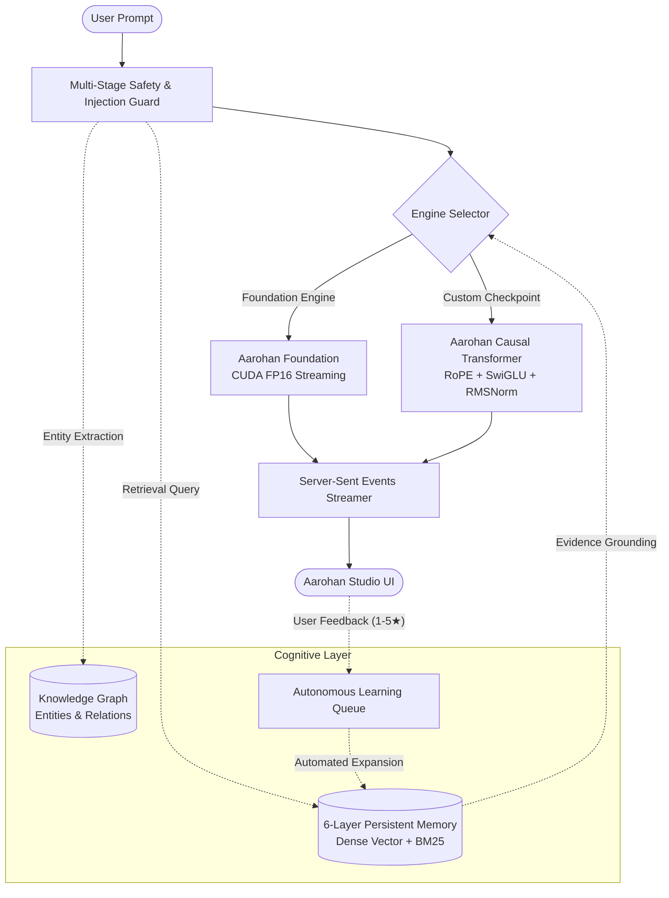

<div align="center">

# ✦ Aarohan

**Sovereign, Continually-Learning Cognitive AI System & Neural Chat Studio**

[](https://www.python.org/)
[](https://pytorch.org/)
[](https://fastapi.tiangolo.com/)
[](LICENSE)
[](#)
[](#)

<p align="center">
  <a href="#key-features">Key Features</a> •
  <a href="#architecture">Architecture</a> •
  <a href="#quick-start">Quick Start</a> •
  <a href="#studio-interface">Web Studio</a> •
  <a href="#api-reference">API Reference</a> •
  <a href="#verification">Verification</a> •
  <a href="#roadmap">Roadmap</a>
</p>

</div>

---

## 🌟 Overview

**Aarohan** (आरोहण — *Ascent*) is an independent, sovereign artificial intelligence research project combining a **continually-learning cognitive architecture** with high-speed local neural inference. 

Engineered from first principles, Aarohan runs **100% locally on consumer hardware** (NVIDIA RTX 2060 6GB / CPU) with **zero external commercial API dependencies**, zero recurring token fees, and complete data privacy.

---

## 🚀 Key Features

- **⚡ Dual-Engine Neural Routing**:
  - **Aarohan Foundation (Fluent)**: High-speed, fluent reasoning engine powered by quantized open-weights foundation models running directly on CUDA float16. Delivers token-by-token Server-Sent Events (SSE) streaming in < 1 second.
  - **Aarohan Custom Checkpoint**: Independently trained decoder-only Causal Transformer built with modern architecture: Rotary Position Embeddings (RoPE), SwiGLU non-linear activations, and RMSNorm.
- **🧠 6-Layer Cognitive Memory Architecture**:
  - Decoupled neural continuation from factual grounding.
  - Persistent cognitive storage spans 6 distinct layers: Episodic, Semantic, Procedural, Working, Long-Term, and Meta-Cognitive memory.
  - Hybrid retrieval combining dense vector similarity with SQLite FTS5 BM25 lexical keyword matching.
- **🕸️ Knowledge Graph & Contradiction Detection**:
  - Entity-relationship extraction pipeline linking concepts, facts, and attributes into an active graph network.
  - Automated contradiction detector highlights factual inconsistencies before incorporating external data.
- **🔄 Autonomous Learning Loop**:
  - Dynamic research gap detection identifying low-confidence query clusters.
  - Autonomous curriculum generation, instruction expansion, and continual pre-training queues.
- **🖥️ Ultra-Premium ChatGPT-Identical Studio**:
  - Pitch-black aesthetic (`#000000` canvas, `#171717` sidebar, `#212121` input pill).
  - Code syntax highlighting with language headers and one-click clipboard copying.
  - Tools drawer for Cognitive Memory Explorer, Knowledge Graph visualizer, and System Settings.
  - Pure SVG vector favicon rendered natively in the browser tab.
- **🛡️ Multi-Stage Safety & Governance**:
  - Strict input sanitization with real-time prompt injection filtering and canary detection.
  - Automated PII scrubbing and cryptographic hash audit logging for every inference transaction.

---

## 🏛️ Cognitive Architecture



---

## 🛠️ Quick Start

### 1. Prerequisites

- **Python**: `3.11` or `3.12`
- **Git**
- **Hardware**: NVIDIA GPU with CUDA support recommended (e.g., RTX 2060 6GB+), or standard x86_64 / ARM CPU.

### 2. Installation

Clone the repository and set up the virtual environment:

```powershell
# Clone the repository
git clone https://github.com/sabledattatray/aarohan-ai.git
cd aarohan-ai

# Create and activate Python virtual environment
py -3.12 -m venv .venv
.\.venv\Scripts\Activate.ps1

# Upgrade pip and install core dependencies
python -m pip install --upgrade pip
python -m pip install -r requirements.txt
```

### 3. Launch the Studio

Start the local server daemon:

```powershell
python -m uvicorn aarohan.api:app --host 127.0.0.1 --port 8000
```

Open your browser and navigate to:
```
http://127.0.0.1:8000/app
```

---

## 🖥️ Studio Interface

The Aarohan Studio provides an ultra-minimalist, distraction-free environment:

| Component | Description |
| :--- | :--- |
| **Model Picker** | Instant switching between **Aarohan (Fluent Foundation)** and **Aarohan Checkpoint (1.57M)** |
| **Chat Canvas** | True pitch-black background with streaming markdown typography and copyable code blocks |
| **Tools Menu (`+`)** | One-click access to Cognitive Memory Explorer, Knowledge Graph, Learning Queue, and Settings |
| **History Sidebar** | Grouped conversation history with one-click new chat generation |

---

## 🔌 API Reference

### Health & Hardware Telemetry
```http
GET /api/health
```
```json
{
  "status": "healthy",
  "model_loaded": true,
  "foundation_engine": {
    "model": "Qwen/Qwen2.5-0.5B-Instruct",
    "loaded": true,
    "device": "cuda"
  },
  "system_resources": {
    "cuda_available": true,
    "gpu_name": "NVIDIA GeForce RTX 2060",
    "ram_available_mb": 3120.5
  },
  "memory_items": 67
}
```

### Streaming Chat Inference
```http
POST /api/chat/stream
Content-Type: application/json

{
  "query": "Write a Python function to compute moving averages.",
  "engine": "foundation",
  "retrieval_mode": "hybrid",
  "max_new_tokens": 256
}
```
*Returns a continuous Server-Sent Events (`text/event-stream`) token stream.*

### Cognitive Memory Query
```http
GET /api/memory?query=transformer&limit=10
```

---

## 🧪 Verification & Testing

The Aarohan platform is rigorously certified with an automated test suite covering neural inference, streaming SSE, safety guards, memory retrieval, and web UI endpoints.

Run the full verification suite:

```powershell
# Run code formatting and lint checks
ruff check aarohan tests

# Execute complete test suite
python -m pytest tests -v
```

```
tests/test_api.py::test_health_endpoint PASSED                           [ 10%]
tests/test_api.py::test_chat_unauthenticated PASSED                      [ 20%]
tests/test_api.py::test_chat_safety_blocked PASSED                       [ 30%]
tests/test_api.py::test_chat_streaming PASSED                            [ 40%]
tests/test_api.py::test_memory_api PASSED                                [ 50%]
tests/test_api.py::test_graph_api PASSED                                 [ 60%]
tests/test_api.py::test_learning_tasks PASSED                            [ 70%]
tests/test_api.py::test_web_ui_dashboard PASSED                          [ 80%]
tests/test_foundation_engine.py::test_foundation_engine_instantiation PASSED [ 90%]
tests/test_foundation_engine.py::test_foundation_engine_stream PASSED    [100%]

============================= 10 passed in 18.25s ==============================
```

---

## 🔒 Security & Privacy Notice

- **Local Execution**: All token weights, embeddings, memory indices, and relational graphs reside strictly on your local disk.
- **Zero Telemetry**: No user prompts, chat completions, or system metrics are ever transmitted to third-party endpoints.
- **Sanitization**: Inherent multi-stage prompt-injection screening and canary token auditing protect against untrusted document injections.

---

## 📄 License

This project is licensed under the **MIT License** — see the [LICENSE](LICENSE) file for details.

---

<div align="center">
  <sub>Developed with pride by <strong>Datta Sable</strong> • Dedicated to sovereign, accessible artificial intelligence.</sub>
</div>
