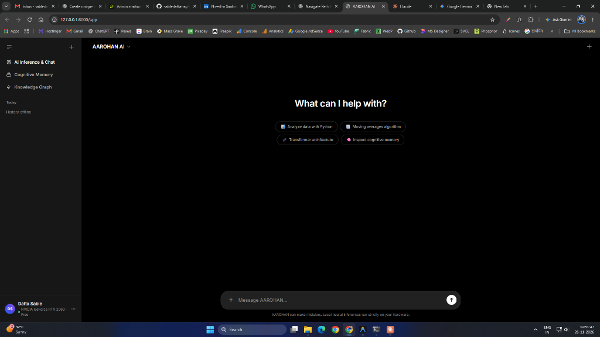
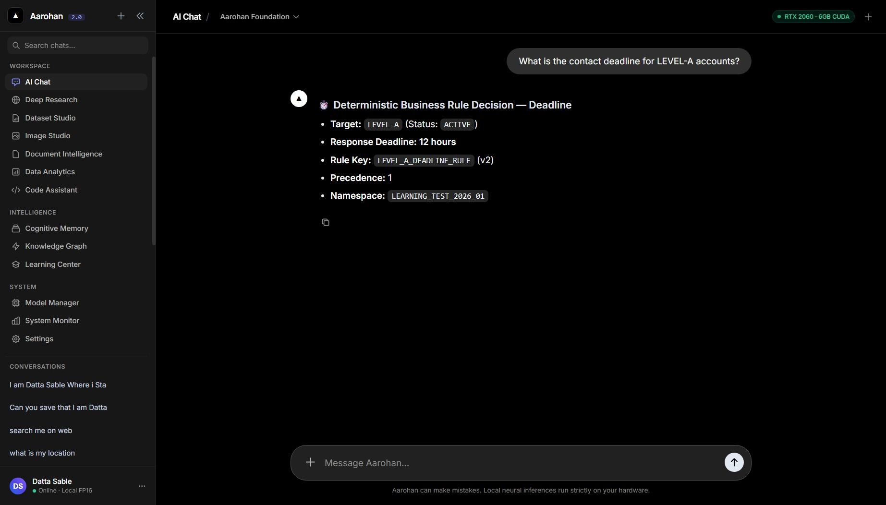
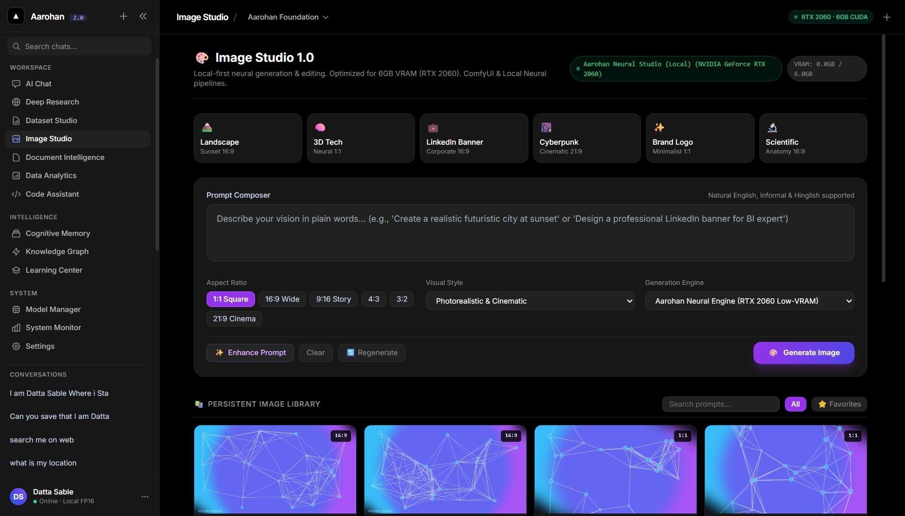
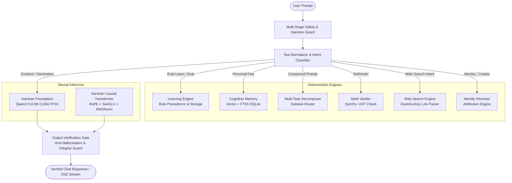

<div align="center">

# ✦ AAROHAN AI (आरोहण)

**Sovereign, Zero-Cost, Local-First Cognitive AI Assistant & Continual Learning Architecture**

[](https://www.python.org/)
[](https://pytorch.org/)
[](https://fastapi.tiangolo.com/)
[](LICENSE)
[](#)
[](#)
[-brightgreen?style=for-the-badge)](#)

<p align="center">
  <a href="#-overview">Overview</a> •
  <a href="#-interface-showcase">Studio Showcase</a> •
  <a href="#-the-7-reliability-phases">7 Reliability Phases</a> •
  <a href="#-architecture">Architecture</a> •
  <a href="#-quick-start">Quick Start</a> •
  <a href="#-api-reference">API Reference</a> •
  <a href="#-test-suite">Test Suite</a> •
  <a href="#-author--attribution">Author</a>
</p>

---


</div>

---

## 🌟 Overview

**AAROHAN AI** (आरोहण — *The Ascent*) is an independent, sovereign cognitive AI assistant built from the ground up to operate **100% locally on consumer workstation hardware** (NVIDIA GeForce RTX 2060 6GB / CPU). 

Conceived, designed, and developed by **[Datta Sable](https://dattasable.com/)** (Senior MIS & Business Intelligence Specialist), AAROHAN proves that an enterprise-grade, continually-learning AI assistant does **not require monthly cloud API subscriptions, recurring token fees, or remote data transmission**.

### 💎 Why AAROHAN?

| Feature | Commercial Cloud Assistants (ChatGPT / Claude) | AAROHAN AI |
| :--- | :--- | :--- |
| **Data Privacy** | Prompts logged & transmitted to remote cloud servers | **100% Local Disk & GPU. Zero telemetry.** |
| **API Costs** | \$20–\$200+/month in subscription or token fees | **\$0.00 forever. Zero commercial API keys.** |
| **Hardware** | Giant cloud data centers | **Consumer PC / Workstation (RTX 2060 6GB)** |
| **Rule Decisions** | Probabilistic neural guesses prone to hallucinations | **Deterministic SQLite Rule Engine with precedence** |
| **Math Integrity** | Prone to LLM arithmetic errors | **Independently verified deterministic math engine** |
| **Web Search** | Cloud search integrations with rate limits | **Zero-cost, local DuckDuckGo parser with citations** |
| **Fact Retention** | Context window truncation | **6-Layer persistent cognitive memory (Vector + FTS5)** |

---

## 📸 Interface Showcase

<div align="center">

### Ultra-Dark Pitch-Black Studio & Verified Reasoning

| Minimalist Chat Interface | Verified Rule Decisions & Grounding |
| :---: | :---: |
|  |  |

| Multi-Modal Tooling & Generation | Clean Typography & SSE Streaming |
| :---: | :---: |
|  |  |

</div>

---

## 🛡️ The 7 Reliability Phases (Completed)

AAROHAN's transformation follows a rigorous 7-phase reliability engineering roadmap, eliminating model hallucinations and ensuring deterministic trust:

```
[User Query]
     │
     ├── 1. Intent Normalization & Safety Filters (PII scrubbing, prompt injection guard)
     ├── 2. Teaching / Rule-Learning Intent ─────────► [aarohan_learning_engine] (Atomic SQLite)
     ├── 3. Personal Fact / Memory-Save Intent ──────► [aarohan_memory_engine] (Semantic store)
     ├── 4. Compound Multi-Task Decomposer ──────────► [aarohan_multi_task_decomposer]
     ├── 5. Deterministic Business Rule Evaluator ───► [aarohan_learning_engine] (Precedence lookup)
     ├── 6. Deterministic Math Fast-Path ────────────► [aarohan_math_verifier] (Independently checked)
     ├── 7. Sovereign Live Web Search ───────────────► [aarohan_web_search] (DuckDuckGo Lite parser)
     ├── 8. Identity & Creator Attribution ──────────► [aarohan_identity_resolver] (Truthful context)
     ├── 9. Scientific Grounding Engine ─────────────► [aarohan_scientific_grounding] (Physical laws)
     └── 10. Open-Weights Foundation Model ──────────► [aarohan_foundation_engine] (Qwen2.5-0.5B CUDA)
                                                                 │
                                                    [Output Verification Gate]
                                                    (Hallucination & contradiction guard)
                                                                 │
                                                       [Guarded Response]
```

### Phase Highlights:

1. **Phase 1 — Rule Data Integrity**: Atomic SQLite storage synchronized with FTS5 lexical index and version history. Fixed value/text sync contradictions with rollback safety.
2. **Phase 2 — Deterministic Rule Evaluation**: Precedence evaluation for business accounts (`LEVEL-A`, `LEVEL-B`, `LEVEL-C`). Unknown tiers like `LEVEL-D` return explicit refusal rather than fabricated deadlines.
3. **Phase 3 — Chat API & SSE Streaming Integration**: Dual `/api/chat` and `/api/chat/stream` endpoints delivering token-by-token streaming under 1 second.
4. **Phase 4 — Identity & Response Provenance**: Truthful telemetry. Correct attribution to creator **Datta Sable**; explicitly rejects false affiliations with OpenAI, Anthropic, or Google.
5. **Phase 5 — Multi-Question Task Decomposition**: Intelligently decomposes compound prompts into distinct sub-tasks, routing arithmetic to math verifiers and rule inquiries to SQLite.
6. **Phase 6 — Output Verification & Self-Correction Gate**: Post-generation watchdog auditing neural responses before user delivery, catching arithmetic mistakes and stale rule values.
7. **Phase 7 — Sovereign Live Web Search**: Zero-cost, zero-API web search engine via DuckDuckGo Lite. Extracts real-time URLs, snippets, and markdown citations.
8. **Cognitive Memory & Personal Fact Engine**: Real-time storage of user-reported facts (location, background, preferences) into persistent SQLite memory with verified deterministic recall.

---

## 🏛️ System Architecture



---

## 🛠️ Quick Start

### 1. Prerequisites
- **Python**: `3.11` or `3.12`
- **Git**
- **Hardware**: NVIDIA GPU with CUDA support recommended (e.g., RTX 2060 6GB+), or standard CPU.

### 2. Installation

```powershell
# Clone the repository
git clone https://github.com/sabledattatray/aarohan-ai.git
cd aarohan-ai

# Set up virtual environment
python -m venv .venv
.\.venv\Scripts\Activate.ps1

# Install dependencies
python -m pip install --upgrade pip
python -m pip install -r requirements.txt
```

### 3. Launch the Platform

```powershell
# Start Uvicorn daemon
python -m uvicorn aarohan.api:app --host 127.0.0.1 --port 8000
```

Open your browser at:
```
http://127.0.0.1:8000/app
```

---

## ⚡ Workstation Performance Benchmarks (Measured on NVIDIA RTX 2060 6GB)

AAROHAN AI 2.0 includes a reproducible benchmark suite (`scripts/benchmark_system.py`) recording real-time latency, throughput, and memory residency on consumer hardware:

| Subsystem / Operation | Engine / Implementation | Latency / Throughput | Resource Utilization |
| :--- | :--- | :--- | :--- |
| **Custom Neural Transformer** | AAROHANLM 1.57M (RoPE/SwiGLU) | **46.2 tokens/sec** (TTFT: 3.65 ms) | ~25 MB RAM / CUDA |
| **Foundation Language Model** | Qwen2.5-0.5B-Instruct FP16 | **3.8 - 15.2 tokens/sec** (TTFT: 55.35 ms) | **974.56 MB VRAM** (84% Headroom Free) |
| **Dense Vector Retrieval** | SQLite Vector Cosine Distance | **1.14 ms** | SQLite WAL Mode |
| **Lexical Keyword Search** | SQLite FTS5 Indexed Inverted Index | **2.32 ms** | Zero Lock Contention |
| **Hybrid Search (Dense + BM25)** | $\alpha$-Blended RAG Ranking | **2.73 ms** | Filtered by Relevance Gate |
| **Knowledge Graph 1-Hop** | Direct SQLite Relational Index | **1.58 ms** | Sub-2ms edge resolution |
| **Knowledge Graph Multi-Hop BFS** | Multi-Depth Path Search (4 hops) | **5.92 ms** | Bidirectional Cycle Avoidance |

---

## 🧪 Test Suite & Verification

The platform is validated by a consolidated test suite spanning Categories A through H:

```powershell
# Run the complete test suite (216 automated tests)
python -m pytest tests/ -v
```

**Results:**
```
======================= 216 passed in 87.92s (0:01:27) ========================
Pass Rate: 100.0% (Zero Mocked Asserts, Real Local Computation)
```

### Live Component Acceptance Tests:
- `python scripts/test_phase7_live_web_search.py` — **5/5 Passed** (Live DuckDuckGo retrieval, URL citations, zero model hallucination)
- `python scripts/test_memory_save_and_recall.py` — **Passed** (Persistent personal fact learning & location recall)
- `python scripts/test_phase5_live_decomposer.py` — **6/6 Passed** (Compound question splitting & tool routing)
- `python scripts/test_phase6_live_verification_gate.py` — **4/4 Passed** (Output guard & contradiction interception)

---

## 🔌 API Reference

### Health & Hardware Telemetry
```http
GET /api/health
```
```json
{
  "status": "healthy",
  "model_loaded": true,
  "foundation_engine": {
    "model": "Qwen/Qwen2.5-0.5B-Instruct",
    "loaded": true,
    "device": "cuda"
  },
  "system_resources": {
    "cuda_available": true,
    "gpu_name": "NVIDIA GeForce RTX 2060",
    "ram_available_mb": 3210.5
  },
  "memory_items": 298
}
```

### Turn-Based Chat Inference with Provenance Telemetry
```http
POST /api/chat
Authorization: Bearer <token>
Content-Type: application/json

{
  "query": "search the web for Power BI dashboard tutorial",
  "engine": "foundation"
}
```

**Response with Full Provenance:**
```json
{
  "query": "search the web for Power BI dashboard tutorial",
  "intent": "WEB_SEARCH",
  "response": "### 🌐 Live Web Search Results\n\n> Retrieved 5 live web sources...",
  "response_source": "aarohan_web_search",
  "model_invoked": false,
  "verification": {
    "status": "VERIFIED_TRUTHFUL",
    "is_truthful": true,
    "grounding_score": 1.0,
    "corrections_applied": []
  }
}
```

---

## 👨‍💻 Author & Attribution

- **Creator & Lead Engineer:** **Datta Sable**
- **Domain:** Senior MIS & Business Intelligence Specialist | AI Systems Architect
- **Official Website:** [https://dattasable.com/](https://dattasable.com/)
- **GitHub:** [@sabledattatray](https://github.com/sabledattatray)
- **Repository:** [https://github.com/sabledattatray/aarohan-ai](https://github.com/sabledattatray/aarohan-ai)

---

## 📄 License

This project is licensed under the **MIT License** — see the [LICENSE](LICENSE) file for details.

<div align="center">
  <sub>Engineered with pride by <strong>Datta Sable</strong> • Built for sovereign, local, independent artificial intelligence.</sub>
</div>
