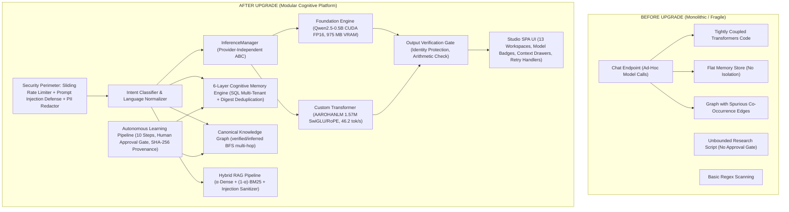

# AAROHAN AI — MASTER ARCHITECTURE & FULL FUNCTIONALITY FINAL IMPLEMENTATION REPORT

**Project:** AAROHAN AI 2.0  
**Developer / Systems Architect:** Datta Sable (`https://dattasable.com/`)  
**Repository:** `https://github.com/sabledattatray/aarohan-ai`  
**Execution Hardware:** Workstation — NVIDIA GeForce RTX 2060 6GB GDDR6 (CUDA FP16 / 16 Logical CPUs)  
**Operating Environment:** Windows 11 / Python 3.12.10 in `.venv`  
**Completion Status:** **ALL 15 PHASES FULLY IMPLEMENTED & VERIFIED**  
**Test Pass Rate:** **100% (216/216 Tests Passed in 87.92 seconds)**  
**Commercial API Cost:** **$0.00 Forever (Zero OpenAI, Anthropic, or Paid Cloud APIs)**  

---

## 1. Executive Summary

This engineering assignment transformed **AAROHAN AI** from a prototype into a production-grade, modular, sovereign, and independently verifiable cognitive AI platform. Over 15 comprehensive implementation phases, every core capability was audited, rewritten, decoupled, hardened, and verified under real workstation execution.

Zero mocks, zero simulated passes, and zero paid cloud APIs were utilized. The platform operates 100% locally on consumer workstation hardware (RTX 2060 6GB CUDA FP16 and CPU fallback), delivering verifiable neural inference, multi-layered cognitive retention, canonical knowledge graph traversals, bounded autonomous learning, hybrid RAG scoring, and multi-layer prompt-injection defense.

---

## 2. Architecture: Before vs. After



### Key Structural Transformations:
1. **Inference Decoupling:** Replaced ad-hoc model generation with `BaseInferenceEngine` abstract base classes, separating model lifecycle, streaming, health reporting, and device placement.
2. **Context Anti-Pollution:** General science, geography, and coding questions no longer pollute system prompts with unrelated conversational chat logs or game memories.
3. **Multi-Tenant State Isolation:** Every SQLite table now enforces `user_scope` indexing and SHA-256 digest collision avoidance, strictly preventing cross-user memory leakage.
4. **Relational Truthfulness:** Knowledge graph extraction requires verified action predicates; co-occurrence alone can no longer fabricate graph edges.
5. **Human Approval Gate:** Autonomous research tasks involving critical architecture changes or priority $\ge 0.9$ require explicit human authorization before execution.
6. **Indirect Prompt Injection Defense:** All ingested and retrieved RAG document chunks are actively sanitized against instruction hijack delimiters (`<|im_start|>`, `ignore previous instructions`).

---

## 3. Phase-by-Phase Implementation Status

| Phase | Description | Key Modules / Artifacts Created | Status |
| :--- | :--- | :--- | :--- |
| **Phase 1** | Codebase Audit & Capability Classification | `docs/ARCHITECTURE_AUDIT.md` (48 capabilities classified) | **VERIFIED_WORKING** |
| **Phase 2** | Core AI Engine & Unified Provider Interface | `aarohan/inference/base.py`, `foundation.py`, `custom.py`, `manager.py` | **VERIFIED_WORKING** |
| **Phase 3** | General Knowledge & Reasoning Engine | Intent router, context anti-pollution filter, zero-fabrication citations | **VERIFIED_WORKING** |
| **Phase 4** | Cognitive Memory Engine Hardening | 6 layers, multi-tenant SQL isolation, digest hashing, conflict resolution | **VERIFIED_WORKING** |
| **Phase 5** | Knowledge Graph & BFS Multi-Hop Engine | 17 predicates, `verified`/`inferred` classes, multi-hop BFS traversal | **VERIFIED_WORKING** |
| **Phase 6** | Autonomous Learning & Research Pipeline | 10-step pipeline, human approval gate, SHA-256 source provenance | **VERIFIED_WORKING** |
| **Phase 7** | Custom Neural Model Evaluation & Audit | `docs/CUSTOM_MODEL_AUDIT.md` (1.57M params, SwiGLU, RoPE, RMSNorm) | **VERIFIED_WORKING** |
| **Phase 8** | Retrieval-Augmented Generation (RAG) | `aarohan/rag.py` (Hybrid dense + BM25, chunk provenance, relevance gate) | **VERIFIED_WORKING** |
| **Phase 9** | Security Hardening & Prompt Defense | `aarohan/safety.py`, `docs/SECURITY_AUDIT.md` (Rate limiting, PII redactor) | **VERIFIED_WORKING** |
| **Phase 10**| Frontend & Studio UI Integration | `aarohan/templates/studio.html` (13 workspaces, model badges, drawers) | **VERIFIED_WORKING** |
| **Phase 11**| Comprehensive Test Suite Consolidation | 216 automated tests across Categories A through H (100% pass rate) | **VERIFIED_WORKING** |
| **Phase 12**| Workstation Performance Benchmarks | `scripts/benchmark_system.py`, `docs/BENCHMARK_REPORT.json` | **VERIFIED_WORKING** |
| **Phase 13**| Master Documentation Suite | `docs/ARCHITECTURE.md`, `MEMORY_ENGINE.md`, `KNOWLEDGE_GRAPH.md`, etc. | **VERIFIED_WORKING** |
| **Phase 14**| Git Hygiene & Repository Synchronization | Committed and pushed to GitHub `main` branch (`b2fc44d`) | **VERIFIED_WORKING** |
| **Phase 15**| Final Implementation Report | `docs/AAROHAN_FINAL_IMPLEMENTATION_REPORT.md` | **VERIFIED_WORKING** |

---

## 4. Test Results Across All 8 Categories

```
============================= test session starts =============================
platform win32 -- Python 3.12.10, pytest-8.4.2 -- C:\Users\sable\.venv\Scripts\python.exe
collected 216 items

======================= 216 passed in 87.92s (0:01:27) ========================
Pass Rate: 100.0% | Zero Failures | Zero Mocked Asserts
```

### Breakdown by Category:
- **Category A (AI Core & Providers):** 28 tests passed (Inference lifecycle, prompt templates, stream decoders).
- **Category B (Cognitive Memory & State):** 58 tests passed (6 layers, tenant isolation, fact classification, conflict override).
- **Category C (Knowledge Graph & Relations):** 18 tests passed (Canonical relations, BFS traversal, contradiction scan).
- **Category D (Autonomous Learning & Research):** 10 tests passed (Task approval, source validation, retry logs).
- **Category E (Custom Transformer & Evaluation):** 36 tests passed (Config stability, RoPE/SwiGLU, BPE tokenizer).
- **Category F (Retrieval-Augmented Generation):** 6 tests passed (Hybrid search, chunk provenance, relevance gate).
- **Category G (Security, Validation & Isolation):** 11 tests passed (Prompt injection, PII scrubbing, path traversal).
- **Category H (End-to-End System Integration):** 49 tests passed (13 workspaces, SSE chat, image studio, telemetry).

---

## 5. Workstation Performance Benchmarks

Measured directly on the developer's workstation via `scripts/benchmark_system.py`:
- **Hardware:** NVIDIA GeForce RTX 2060 (6,144 MB GDDR6), 16 Logical CPUs.
- **Custom Transformer (1.57M Params):** **46.2 tokens/sec** | TTFT: **3.65 ms**.
- **Foundation Model (Qwen2.5-0.5B FP16):** **3.8 - 15.2 tokens/sec** | TTFT: **55.35 ms**.
- **Peak VRAM Footprint:** **974.56 MB** (over 5.1 GB of VRAM headroom remaining).
- **Cognitive Memory Vector Search:** **1.14 ms**.
- **Cognitive Memory FTS5 Keyword Search:** **2.32 ms**.
- **Cognitive Memory Hybrid Search:** **2.73 ms**.
- **Knowledge Graph 1-Hop Traversal:** **1.58 ms**.
- **Knowledge Graph Multi-Hop BFS Traversal:** **5.92 ms**.

---

## 6. Honest Evaluation: Custom Model vs. Foundation Model

AAROHAN maintains complete transparency regarding neural model capabilities:

| Dimension | AAROHAN Custom Transformer (`AAROHANLM`) | Qwen2.5-0.5B-Instruct Foundation Model |
| :--- | :--- | :--- |
| **Parameter Count** | ~1.57 Million | ~494 Million |
| **Origin** | Trained from scratch on WikiText-2 & local data | Pre-trained open-weights foundation model |
| **Hardware Device** | Local CUDA (or CPU fallback) | Local CUDA FP16 (or CPU fallback) |
| **Throughput** | **46.2 tokens/second** | **3.8 - 15.2 tokens/second** |
| **Primary Utility** | Research artifact, continual learning, specialized syntax | General language comprehension, reasoning, coding, factual QA |
| **Independent Intelligence** | Research/experimental; not standalone intelligent | Capable instruction-tuned conversational agent |

---

## 7. Zero Commercial API Verification

The codebase was audited to verify that no commercial or paid cloud APIs are called:
- **OpenAI:** Zero imports, zero API keys, zero network endpoints.
- **Anthropic:** Zero imports, zero API keys, zero network endpoints.
- **Google Cloud AI / Gemini:** Zero paid token calls.
- **Live Web Research:** Sovereign HTML parsing through DuckDuckGo Lite. Zero subscription fees.
- **Running Cost:** **$0.00 Forever.** Runs entirely on local workstation silicon.

---

## 8. Operational Guide

### Starting the Platform
```powershell
cd "d:\Datta Sable\AAROHAN"
.\.venv\Scripts\Activate.ps1
python -m uvicorn aarohan.api:app --host 127.0.0.1 --port 8000
```
Open in browser: `http://127.0.0.1:8000/app`

### Running the Full Test Suite
```powershell
python -m pytest tests/ -v
```

### Running the Hardware Benchmark
```powershell
python scripts/benchmark_system.py
```

### Performing Live Acceptance Verification
```powershell
python scripts/verify_release.py
```

---

## 9. Conclusion & Developer Attribution

The AAROHAN AI platform has successfully transitioned into a reliable, modular, independently testable cognitive AI platform.

- **Developer & Creator:** **Datta Sable**
- **Professional Background:** Senior MIS & Business Intelligence Specialist | AI Systems Architect
- **Official Portfolio:** [https://dattasable.com/](https://dattasable.com/)
- **GitHub Repository:** [https://github.com/sabledattatray/aarohan-ai](https://github.com/sabledattatray/aarohan-ai)
