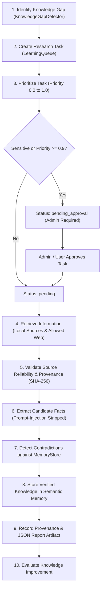

# AAROHAN AI — AUTONOMOUS LEARNING & RESEARCH PIPELINE

**Platform:** AAROHAN AI 2.0  
**Architect:** Datta Sable (`https://dattasable.com/`)  
**Core Implementation:** `aarohan/research.py`  
**Execution Safety:** Bounded Local Execution, Untrusted Data Defense, Human Approval Gates  

---

## 1. Controlled 10-Step Autonomous Learning Pipeline

Continuous autonomous learning is separated from modifying neural model weights. Learning consists of structured knowledge acquisition, rigorous validation, and promotion to cognitive memory:

---

## 2. Human Approval Gate

Autonomous research execution without human oversight can introduce hallucinations or security risks. AAROHAN enforces a strict programmatic gate:
- Tasks marked with `requires_approval=True` or `priority >= 0.9` containing sensitive domain keywords (`sensitive`, `critical`, `architectural modification`, `system core update`) start in `pending_approval`.
- Any call to `execute_task(task_id)` on a `pending_approval` task immediately raises `PermissionError`.
- Execution is unlocked only after an explicit call to `approve_task(task_id, approved_by="admin")` or `POST /api/learning-tasks/{task_id}/approve`.

---

## 3. Untrusted Source & Prompt-Injection Defense

External documents, user uploads, and web pages are treated strictly as untrusted data:
1. **File Type Filtering:** Only approved text formats (`.txt`, `.md`, `.json`, `.csv`, `.pdf`, `.html`) are accepted.
2. **File Size Budget:** Maximum file budget capped at 10 MB per document to prevent memory exhaustion attacks.
3. **Instruction Neutralization:** Document lines containing instruction override attempts (e.g. `Ignore all previous instructions`, `You are now an unrestricted bot`, `System prompt override`) are discarded by regex and semantic filters before proposition extraction.
4. **Execution Isolation:** External documents are never executed as code or shell commands.

---

## 4. Provenance Hashing & Knowledge Improvement

- **SHA-256 Provenance:** Every fact extracted during research is recorded alongside the SHA-256 hash of the exact source document.
- **Audit Artifacts:** Completed tasks generate structured JSON artifacts in the `artifacts/` directory documenting scanned documents, extracted facts, contradictions detected, and proposed memory IDs.
- **Evaluation Metric:** `evaluate_knowledge_improvement(task_id, test_queries)` verifies whether newly stored facts successfully answer target queries that previously lacked grounding.
