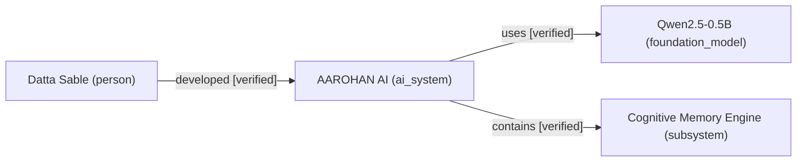

# AAROHAN AI — KNOWLEDGE GRAPH SPECIFICATION

**Platform:** AAROHAN AI 2.0  
**Architect:** Datta Sable (`https://dattasable.com/`)  
**Core Implementation:** `aarohan/memory.py`  
**Relational Storage:** SQLite with Dynamic Migrations and Foreign Key Traversal  

---

## 1. Knowledge Graph Architecture

The AAROHAN Knowledge Graph stores structured factual triples $(S, P, O)$ linking named entities through typed, bidirectional relationships with confidence scoring, temporal validity, and canonical verification classes.



---

## 2. Relation Taxonomy & Canonical Verification Classes

### 2.1 Supported Relational Predicates
The system strictly enforces a controlled vocabulary of 17 canonical relation types:
- `developed`, `developed_by`, `created_by`
- `uses`, `used_in`, `implements`, `evaluates`
- `contains`, `part_of`, `depends_on`, `resides_in`
- `associated_with`, `causes`, `is_a`, `derived_from`
- `contradicts`, `trained_on`

### 2.2 Canonical Verification Classes
Every relationship is tagged with an immutable verification class:
- `verified`: Grounded in explicit user instruction, verified system documentation, or human approval.
- `inferred`: Derived through multi-hop deduction or autonomous research extraction.

---

## 3. Extraction Without Spurious Co-Occurrence

A foundational principle of AAROHAN is that **mere co-occurrence of two entities in a sentence or paragraph does NOT constitute a relationship**.

```
Paragraph: "Datta Sable was walking in Mumbai while the Qwen model was being downloaded."
Extraction:
  - Entities Detected: "Datta Sable", "Mumbai", "Qwen model"
  - Relations Extracted: ZERO (No relational verb or predicate exists between them)
```

The relation extraction pipeline requires explicit action predicates matching known relational patterns (e.g. `X created Y`, `X developed Y`, `X is located at Y`). Sentences lacking relational verbs produce entity records but zero edge insertions.

---

## 4. Multi-Hop Graph Traversal (BFS)

Multi-hop queries (e.g. "What systems depend on technologies developed by Datta Sable?") are resolved using `find_path(source_name, target_name, max_depth=4)`:
- Implemented as a Breadth-First Search (BFS) algorithm traversing the SQLite adjacency table.
- Traversal avoids cycles using a visited node set.
- Supports directional filters (`outgoing`, `incoming`, or `both`).
- Returns the complete path sequence along with predicate types and confidence scores:
  `Datta Sable` $\xrightarrow{\text{developed}}$ `AAROHAN AI` $\xrightarrow{\text{uses}}$ `Qwen2.5-0.5B`.

---

## 5. Contradiction Detection & Temporal Validity

### 5.1 Inverse Contradictions
Relations tagged with `contradicts` are flagged automatically when querying entity neighborhoods.

### 5.2 Temporal Validity
Each relationship supports `valid_from` and `valid_until` ISO-8601 timestamps:
- If a fact is superseded (e.g. office moved from City A to City B), `valid_until` on the old edge is set to the current timestamp.
- Historical traversals can inspect time-stamped graph snapshots without data destruction.
