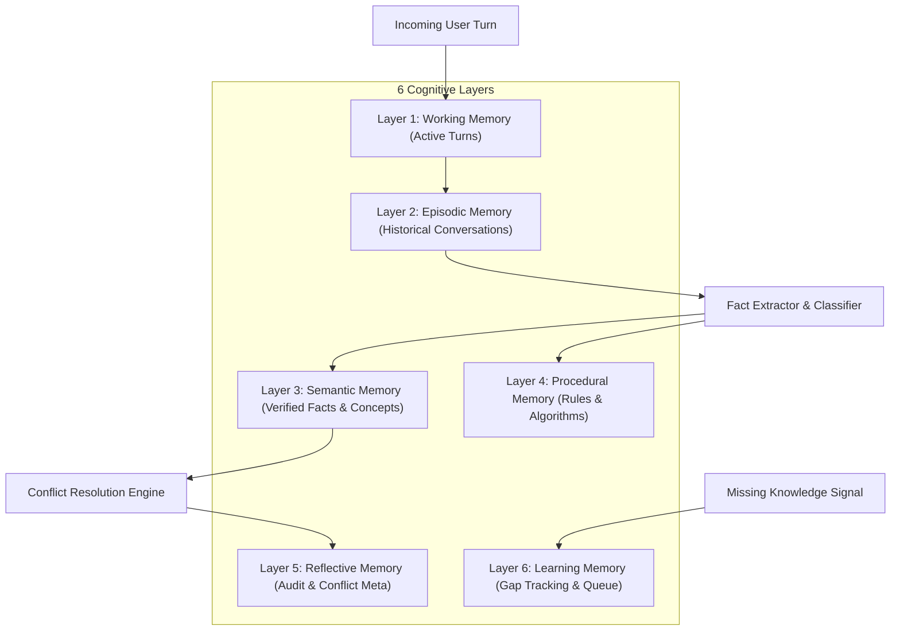

# AAROHAN AI — COGNITIVE MEMORY ENGINE SPECIFICATION

**Platform:** AAROHAN AI 2.0  
**Architect:** Datta Sable (`https://dattasable.com/`)  
**Core Implementation:** `aarohan/memory.py`  
**Storage Architecture:** SQLite WAL Mode with Multi-Tenant Column Scoping & FTS5 Indexing  

---

## 1. Six-Layer Cognitive Architecture

The memory system models cognitive retention across 6 distinct functional layers:



### Layer Details:
1. **Working Memory (`working`):** Short-lived conversation buffer holding the active prompt and recent turns.
2. **Episodic Memory (`episodic`):** Chronological log of past sessions, user interactions, and situational context.
3. **Semantic Memory (`semantic`):** Domain knowledge, user preferences, geographic location facts (e.g. Datta Sable stays at Badlapur East), and scientific propositions.
4. **Procedural Memory (`procedural`):** Behavioral rules, workflow guidelines, and execution precedence.
5. **Reflective Memory (`reflective`):** Meta-cognitive traces: contradiction logs, override decisions, and audit events.
6. **Learning Memory (`learning`):** Identified knowledge gaps and autonomous research task definitions.

---

## 2. Multi-Tenant Isolation & Collision Avoidance

### 2.1 SQL-Level Scoping
Every record in `memories` contains a mandatory `user_scope` column:
```sql
CREATE TABLE memories (
    id TEXT PRIMARY KEY,
    user_scope TEXT NOT NULL DEFAULT 'default_user',
    content TEXT NOT NULL,
    memory_type TEXT NOT NULL,
    confidence REAL DEFAULT 1.0,
    importance REAL DEFAULT 0.5,
    verification_status TEXT DEFAULT 'unverified',
    fact_type TEXT DEFAULT 'fact',
    created_at TEXT NOT NULL,
    expires_at TEXT,
    digest TEXT NOT NULL
);
CREATE INDEX idx_memories_scope ON memories(user_scope);
```
All read and write queries enforce `(user_scope = ? OR user_scope = 'default_user')`, strictly preventing cross-user data leakage.

### 2.2 Deduplication Digest Hashing
Duplicate memories are detected and prevented via SHA-256 scoping:
$$\text{digest} = \text{SHA256}(\text{user\_scope} + \text{"::"} + \text{content})$$
Two users storing identical facts receive distinct digests and isolated memory rows.

---

## 3. Contradiction Resolution & Memory Lifecycle

### 3.1 Fact vs Assumption Classification
Before persisting incoming information, `classify_fact_or_assumption(text)` analyzes linguistic modal verbs and uncertainty markers:
- **Assumption:** Marked by "maybe", "probably", "I assume", "might be", "I think". Confidence defaulted to $0.5$.
- **Fact:** Direct declarative statements ("I live at Badlapur East", "Water is H2O"). Confidence defaulted to $0.9$.

### 3.2 Conflict Resolution
When a new memory directly contradicts an existing record (e.g. "I moved to Thane" vs "I stay at Badlapur East"):
1. The system identifies conflicting candidates via semantic cosine similarity.
2. `resolve_conflict(old_id, new_content, verified_by="user_override")`:
   - Archives the old memory with status `superseded` and sets `expires_at = now`.
   - Inserts the new memory with status `verified`.
   - Records an immutable audit trace in Layer 5 Reflective Memory logging the timestamp and override authority.

### 3.3 TTL Expiration and Automatic Purge
Memories with temporary relevance support explicit `ttl_seconds` or `expires_at`:
`POST /api/memory/purge-expired` deletes all records where `expires_at < datetime('now')`, maintaining a lean SQLite database.
