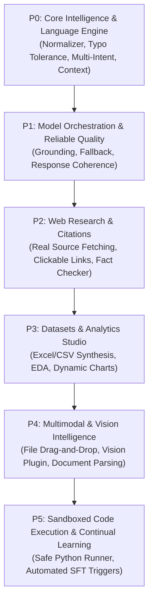

# Aarohan 2.0 — Engineering Roadmap

**Architecture Target:** High-capability, local sovereign AI cognitive assistant  
**Operating Principle:** Zero commercial external LLM dependencies, running 100% on local hardware.

---

## Staged Implementation Plan

---

### Phase P0: Intelligent Query Understanding & Context Resolution
- **Deliverables:**
  - `aarohan/nlp/normalizer.py`: Protects technical entities (`SQL`, `Power BI`, `RoPE`, `CUDA`, etc.) and fixes colloquial/spelling typos.
  - `aarohan/nlp/intent.py`: Multi-intent classification across 21 action categories with confidence scoring.
  - `aarohan/nlp/context.py`: Multi-turn reference resolution (anaphora resolution) linking prior conversational turns.
  - `tests/test_nlp.py`: Full test coverage.
- **Milestone Status:** `VERIFIED & TESTED`.

---

### Phase P1: Model Orchestration & Reliable Answer Quality
- **Goals:**
  - Grounding: Strict system instruction preventing identity hallucinations.
  - Dynamic Model Switching: Seamless handoff between foundation engine (`Qwen2.5-0.5B`) and custom Transformer checkpoints.
  - Token Budget Optimization: Adaptive `max_new_tokens` based on classified intent (e.g., 2048 for code/tables, 256 for greetings).
  - KaTeX Mathematical Formatting: High-fidelity LaTeX formula rendering for scientific and quantitative responses.
- **Target Files:** `aarohan/foundation_engine.py`, `aarohan/api.py`.

---

### Phase P2: Web Research, Real Source Retrieval & Clickable Citations
- **Goals:**
  - Integration of an offline-first search provider (DuckDuckGo HTML backend or SearXNG).
  - Real-time fact extraction from search results into Semantic Memory.
  - In-line bracketed citations (`[1]`, `[2]`) in chat with collapsible source card previews.
- **Target Files:** `aarohan/research.py`, `aarohan/api.py`.

---

### Phase P3: Dataset Studio & Python Analytics
- **Goals:**
  - Synthetic Data Studio for Banking, Sales, E-Commerce, and Employee records.
  - Direct export to `.xlsx` (multi-sheet with openpyxl), `.csv`, `.json`, and `.sql`.
  - Automatic Pandas-based data profiling (column types, min/max, nulls, cardinality).
- **Target Files:** `aarohan/generation/datasets/generator.py`, `aarohan/api.py`.

---

### Phase P4: Multimodal Vision & Document Intelligence
- **Goals:**
  - In-browser file uploader for documents (PDF, CSV, TXT) and images.
  - Document chunking, summarization, and interactive Q&A over uploaded files.
  - Local vision model plugin architecture for image description and OCR.
- **Target Files:** `aarohan/vision/`, `aarohan/api.py`.

---

### Phase P5: Sandboxed Code Execution & Continual Learning
- **Goals:**
  - Secure sandboxed Python subprocess environment with execution timeout (5s) and stdout/stderr capture.
  - Automated continual learning triggering training jobs when high-priority learning gaps accumulate.
  - Automated deployment and rollback gating with verification benchmarking.
- **Target Files:** `aarohan/coding/`, `aarohan/continual.py`, `aarohan/scheduler.py`.
