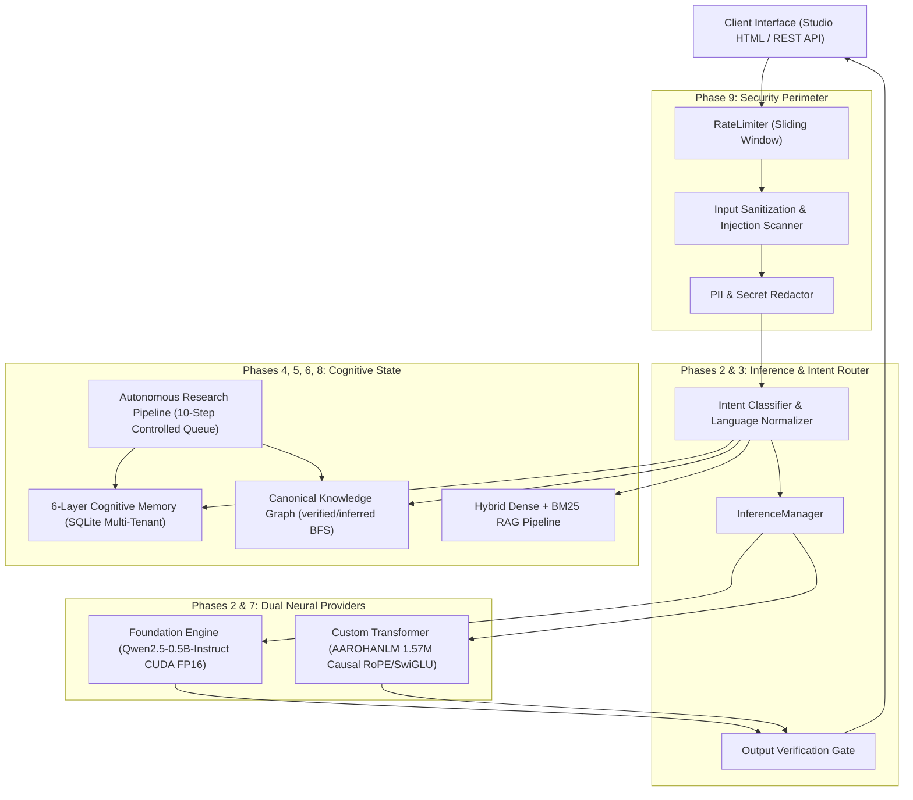

# AAROHAN AI — MASTER SYSTEM ARCHITECTURE DOCUMENT

**Platform:** AAROHAN AI 2.0 Cognitive AI Architecture  
**Architect & Developer:** Datta Sable (`https://dattasable.com/`)  
**Hardware Profile:** NVIDIA GeForce RTX 2060 6GB GDDR6 / 16 Logical CPUs / Windows Workstation  
**Repository:** `https://github.com/sabledattatray/aarohan-ai`  

---

## 1. High-Level Architecture Overview

AAROHAN AI is an independent, zero-commercial-cloud cognitive platform combining local neural language modeling, multi-layered cognitive memory, relational knowledge graphs, autonomous research workflows, and retrieval-augmented generation.

---

## 2. Core Subsystems

### 2.1 Provider-Independent Inference Layer
- Abstract base class: `BaseInferenceEngine` (`aarohan/inference/base.py`).
- Implementations:
  1. `FoundationInferenceEngine`: Hosts `Qwen/Qwen2.5-0.5B-Instruct` in FP16 on local CUDA (~975 MB VRAM).
  2. `CustomTransformerInferenceEngine`: Hosts `AAROHANLM` (~1.57M to 5.39M parameters) pre-trained from scratch with Byte-Level BPE, RoPE positional encoding, RMSNorm, and SwiGLU feed-forward blocks.
- Lifecyle Manager: `InferenceManager` provides hot engine switching, dynamic registration, model capability discovery, and unified streaming.

### 2.2 Cognitive Memory Engine (6 Layers)
- Structured SQLite engine (`aarohan/memory.py`) with user-scoped isolation (`user_scope` column indexed on all tables).
- Layer 1: Working Memory (active dialogue context).
- Layer 2: Episodic Memory (timestamped conversational turns and observations).
- Layer 3: Semantic Memory (verified facts, definitions, and domain propositions).
- Layer 4: Procedural Memory (rules, algorithms, and conditional workflows).
- Layer 5: Reflective Memory (self-evaluations, conflict resolutions, and audit traces).
- Layer 6: Learning Memory (knowledge gaps and queue records).

### 2.3 Knowledge Graph & BFS Multi-Hop Engine
- Relational entity-graph mapping subjects, predicates, and objects.
- Graph edges classified strictly as `verified` (grounded in explicit factual text) or `inferred` (deduced via rule logic).
- Co-occurrence without relational verbs is explicitly prohibited from generating graph edges.
- Breadth-First Search (BFS) multi-hop traversal with path caching and bidirectional cycle avoidance.

### 2.4 Autonomous Learning & Research Pipeline
- 10-step bounded research queue (`aarohan/research.py`) operating on approved local documents.
- Human approval gate: tasks marked sensitive or with priority $\ge 0.9$ start as `pending_approval`.
- Prompt injection defense: untrusted document lines attempting instruction overrides are neutralized during parsing.
- SHA-256 provenance tracking: every fact is permanently linked to its source file hash and timestamp.

### 2.5 Hybrid RAG System
- Multi-format ingestion (`aarohan/rag.py`): PDF, Markdown, TXT, HTML, JSON, CSV with overlap chunking.
- Hybrid Search: $\alpha$-blended dense vector similarity (Euclidean cosine approximation) and BM25 reciprocal rank.
- Indirect prompt injection defense: sanitizes retrieved chunks to prevent document-based jailbreaking.

### 2.6 Application Security & Multi-Tenant Defense
- Sliding window token bucket rate limiter.
- PII and credential scrubber (emails, phone numbers, API keys, passwords, credit cards).
- Path traversal defense: validates target files against parent directory boundaries.
- Error message sanitization: strips internal server paths and DB credentials before returning to client.
